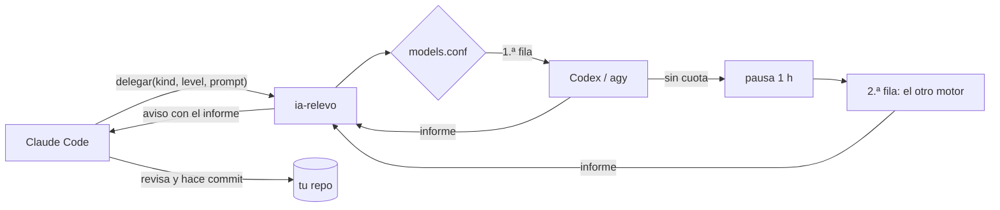

# ia-relevo

[](https://github.com/angelmq152/ia-relevo/actions/workflows/ci.yml)
[](LICENSE)

Un mod de Claude Code que permite a Claude repartir el trabajo de código entre Codex CLI y Antigravity (agy), de modo que esas tareas se paguen con la cuota de OpenAI o de Google y no con la de tu plan de Claude. Claude se queda con la parte de pensar y revisar, y los otros agentes escriben el código.

Claude dispone de una herramienta llamada `delegar`. Cuando la usa, indica el tipo de tarea (`back` para lógica, tests y scripts; `front` para interfaz y motion; `read` para analizar mucho código; `mech` para cambios repetitivos) y su dificultad (`facil`, `normal` o `dificil`). Con esos dos datos, la tabla de [`bin/models.conf`](bin/models.conf) decide qué motor y qué modelo hacen el encargo. Si el motor elegido se queda sin cuota, pasa una hora en pausa y la siguiente fila de la tabla hace el mismo encargo sin que tengas que hacer nada.

Los encargos se ejecutan en segundo plano. Claude solo recibe el informe final del agente, de unas quince líneas, así que su contexto no se llena con la exploración ni con las pruebas del otro agente. Cuando un encargo termina, el mod avisa a la sesión con ese informe, y Claude revisa los cambios y hace el commit. Si hace falta una corrección, la herramienta `seguir` continúa la misma conversación con el agente.



## Cómo se ve

Le pides a Claude un cambio y él decide qué parte delega. La herramienta le responde al momento y él sigue con otra cosa:

```
Started "arreglar-login" in the background (back/dificil: agy claude-opus-5-5-high -, then codex gpt-6-astra high).
Run dir: ~/.claude/relevo-runs/20261017-215217-arreglar-login. Its report arrives as a message when it finishes; do not poll.
```

Cuando el agente termina, llega a la sesión un mensaje como este, y Claude revisa los cambios:

```
[ia-relevo] The delegated task "arreglar-login" finished: engine agy, model claude-opus-5-5-high, exit 0.

Status: OK
Files: src/auth/session.ts, tests/auth.test.ts
Verification: npm test (42 passed)
Errors: none
Pending: none
```

La línea de estado muestra los encargos en marcha y el % usado de los límites de tu plan, por ejemplo `relevo: 2 en curso · 5h 40% · semana 20%`. `/relevo` lista los encargos de la sesión y te dice si algún motor está en pausa por cuota. `/relevo-ahorro [días]` suma lo que han gastado Codex y agy y lo traduce a tokens equivalentes de Claude con los precios relativos de la API. Esa cifra es una estimación, porque el plan no mide exactamente así, pero sirve para hacerse una idea del orden de magnitud.

## Instalación

Necesitas Claude Code, `bash` 4 o posterior, `python3` y al menos uno de los dos agentes instalado y con sesión iniciada: [Codex CLI](https://github.com/openai/codex) (`codex`) o Antigravity CLI (`agy`). Con uno solo funciona, pero entonces no hay relevo cuando ese se queda sin cuota.

En el prompt de una sesión de Claude Code en el terminal:

```
/plugin install ia-relevo --marketplace angelmq152/ia-relevo
```

Desde una shell:

```bash
claude plugin install ia-relevo --marketplace angelmq152/ia-relevo
```

En la app de escritorio, donde `/plugin` no funciona, pulsa el + junto al cuadro del prompt, luego Plugins, Add marketplace con `angelmq152/ia-relevo` y después Add plugin.

Para quitarlo, `/plugin uninstall ia-relevo` o `claude plugin uninstall ia-relevo`. Las ejecuciones guardadas siguen en `~/.claude/relevo-runs` hasta que las borres.

## Qué modelo hace cada cosa

Esta es la tabla que trae el mod. En cada combinación de tipo y nivel, primero se prueba la fila de arriba y, si ese motor se queda sin cuota, la de abajo.

| Tipo | Nivel | Primero | Si no hay cuota |
|---|---|---|---|
| `mech` | cualquiera | agy `gemini-3.8-flash-low` | Codex `gpt-5.6-luna` (low) |
| `read` | cualquiera | agy `gemini-3.8-flash-high` | Codex `gpt-reserve` (medium) |
| `back` | `facil` | Codex `gpt-5.6-luna` (medium) | agy `gemini-3.8-flash-medium` |
| `back` | `normal` | Codex `gpt-reserve` (high) | agy `claude-sonnet-5-5-medium` |
| `back` | `dificil` | agy `claude-opus-5-5-high` | Codex `gpt-6-astra` (high) |
| `front` | `facil` | agy `gemini-3.8-flash-medium` | Codex `gpt-5.6-luna` (medium) |
| `front` | `normal` | agy `claude-sonnet-5-5-medium` | Codex `gpt-reserve` (medium) |
| `front` | `dificil` | agy `claude-opus-5-5-high` | Codex `gpt-6-astra` (high) |

Opus y Sonnet aparecen en la columna de agy porque Antigravity también ofrece modelos de Claude y los cobra con la cuota de Google. Así lo difícil lo sigue haciendo un modelo de Claude sin gastar tu plan.

## Ajustes

Para cambiar qué modelo hace cada tarea, copia `bin/models.conf` a `~/.config/ia-relevo/models.conf` y edítalo. Los nombres de modelo dependen de lo que tenga tu cuenta: `agy models` y la caché de modelos de Codex te dicen cuáles hay. Para ver qué saldría con la tabla sin lanzar nada, usa `bin/relevo.sh plan -k front -l dificil`.

Hay variables de entorno para lo demás: `RELEVO_RUNS` es la carpeta donde se guarda cada ejecución (por defecto `~/.claude/relevo-runs`), `RELEVO_TIMEOUT` es el tiempo máximo por encargo en segundos (3600) y `RELEVO_COOLDOWN` es cuánto tiempo queda en pausa un motor sin cuota (3600).

El script también funciona sin Claude: `bin/relevo.sh run -n prueba -C . -k back -l normal "tu encargo"` lo ejecuta en primer plano y te muestra el informe al terminar.

## Monitorización

Si pones la URL de un OpenTelemetry Collector en la opción `otlpEndpoint` del mod (por ejemplo `http://127.0.0.1:4318`), el mod envía métricas y un evento por cada encargo: qué motor y qué modelo lo hicieron, si salió bien, cuánto tardó, cuántos tokens gastó y si hubo relevo por cuota. También envía los límites de 5 horas y semanal de tu plan, que la telemetría propia de Claude Code no trae. Si sumas la telemetría de Claude Code y la de Codex, tienes las tres herramientas en un mismo Grafana. En [`examples/monitoring`](examples/monitoring) están la configuración del collector, lo que hay que añadir en Claude Code y en Codex, y un panel listo para importar. Si dejas la opción vacía, que es lo que viene por defecto, el mod no envía nada.

## Limitaciones

El ahorro de `/relevo-ahorro` es una estimación hecha con los precios relativos de la API; el límite del plan no se calcula exactamente así. agy en modo headless no puede pedirte permiso para ejecutar comandos de shell, así que deniega los que no tengas en `permissions.allow` de `~/.gemini/antigravity-cli/settings.json`. Un encargo que termina sin respuesta por eso cuenta como fallo, y el informe dice qué acción se denegó. Los agentes nunca hacen commit ni cambian de rama; eso le toca a Claude cuando ha revisado el trabajo. El script necesita `bash` 4 o posterior y `python3`, y está probado en Linux. En macOS no basta con el `bash` 3.2 que trae el sistema: hace falta el de Homebrew y `coreutils` (por `gtimeout`).

## Tests

`bash tests/relevo.test.sh` prueba el script con motores falsos: la tabla de modelos, el relevo cuando un motor se queda sin cuota, las ejecuciones en segundo plano y las respuestas vacías de agy. `claude plugin test .` prueba el cálculo del ahorro, la telemetría y la herramienta `delegar`. GitHub Actions ejecuta los primeros y `shellcheck` en cada push.

## In English

ia-relevo is a Claude Code mod that lets Claude delegate coding tasks to Codex CLI and Antigravity (agy), so they run on your OpenAI or Google quota instead of your Claude plan. Claude picks a kind and a level for each task, `models.conf` maps them to an engine and a model, and an engine that runs out of quota hands the task to the next one. Tasks run in the background, and Claude only reads each agent's short final report. It can also send OTLP metrics, plan limits included, to your own collector.

## Licencia

MIT
